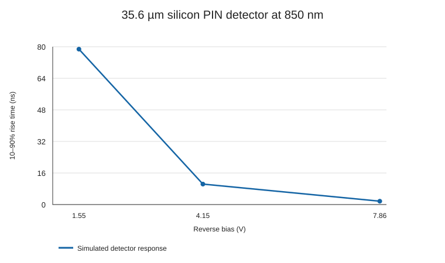
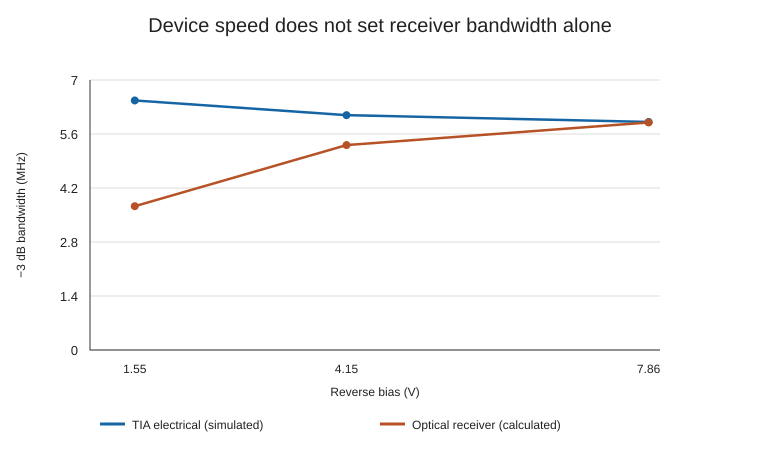

# Silicon PIN Photodiode Modelling and Readout Analysis

A one-dimensional silicon photodiode study linking device response to a transistor-level CMOS readout. The device is simulated in DEVSIM; the electronic interface is simulated in LTspice. The question is whether a faster detector necessarily produces a faster receiver.

The standalone study bundles the device equations, TIA model and settings, physical references, and numerical summaries. All reported device responses come from simulation.

## Main result

For a 35.6 µm absorber at 850 nm, increasing reverse bias from 1.55 to 7.86 V reduced the **simulated** detector 10–90% rise time from 78.8 to 1.70 ns. The **calculated** optical receiver bandwidth increased only from 3.73 to 5.90 MHz: the TIA increasingly limited the overall response.

| Reverse bias | Detector rise time, simulated | Receiver bandwidth, calculated |
|---|---:|---:|
| 1.55 V | 78.7829 ns | 3.72833 MHz |
| 4.15 V | 10.3729 ns | 5.31282 MHz |
| 7.86 V | 1.69990 ns | 5.89934 MHz |

Source: [`pin/receiver_summary.csv`](pin/receiver_summary.csv). The receiver bandwidth combines the simulated device optical-step transfer function with the simulated TIA electrical transfer function. It is **not** a nonlinear, self-consistent TCAD/SPICE co-simulation.




## Model and experiment

- Poisson and electron/hole drift–diffusion equations in a planar p+–n−–n+ silicon structure.
- Assumed absorber thicknesses: 7.9, 20.8 and 35.6 µm. Reverse biases: 1.55, 4.15 and 7.86 V; a full 3×3 grid.
- Assumed active area 0.25 mm², incident power 1 µW, wavelength 850 nm and temperature 300 K.
- Literature-informed silicon optical parameters and field-dependent mobilities, with simplified contacts and SRH recombination. See [`support/references/physical_parameters.md`](support/references/physical_parameters.md).
- The bundled seven-MOS TIA uses generic Level-1 models, 1.8 V core supply, 81.6 kΩ feedback resistance and 0.36 pF feedback capacitance. The detector reverse-bias supply is separate.

Geometry, lifetimes, bias and illumination are **assumed model parameters**. Solver outputs are **simulated**. Photon limits, noise estimates and receiver transfer-function combinations are **calculated**. None are experimental measurements.

The declared reference-selection criterion was responsivity ≥0.28 A/W and time-step-converged optical settling ≤10 ns, preferring the lowest passing bias and then higher responsivity. It selected the 20.8 µm, 4.15 V case (0.3103 A/W). This educational criterion is distinct from the thick-device bias comparison above.

## What is included

```text
run_pin_revision.py          device sweep, time refinement, audits
pin_receiver_revision.py     TIA coupling and receiver analysis
support/scripts/            device equations and shared solver/interface code
support/models/             bundled TIA model
support/references/          physical assumptions and literature citations
tia/                        TIA model and selected settings used by this study
protocol.json               PIN sweep settings and selection criteria
pin/                        historical scalar summaries and validation records
figures/                    figures regenerated from preserved summary data
tools/                      evidence checks and summary-figure generation
generated/                  fresh runs only; created when simulations are run
```

## Reproduce

Python 3.12 was used. A compatible DEVSIM build with its UMFPACK support is needed for device runs. LTspice is required only for the receiver circuit simulations. The tested circuit runner is the LTspice 26.0.2 macOS batch launcher; Windows/Linux runners are not claimed to be validated. No simulator executable is redistributed.

```bash
python3 -m venv .venv
source .venv/bin/activate
python -m pip install -r requirements.txt
python tools/check_evidence.py
python tools/plot_summary.py
python tools/smoke_device.py       # fresh one-case DEVSIM DC/AC check
python tools/smoke_receiver.py     # fresh one-case LTspice AC check

# Run fresh device simulations. Historical pin/ data are never used as a cache.
python run_pin_revision.py --mode initial
python run_pin_revision.py --mode refine
python run_pin_revision.py --mode audit
python run_pin_revision.py --mode summary

# Simulate the receiver using the generated device waveforms.
python pin_receiver_revision.py --mode simulate
python pin_receiver_revision.py --mode admittance
python pin_receiver_revision.py --mode summary
```

By default the batch launcher is `/Applications/LTspice.app/Contents/SharedSupport/ltspice/LTspice/run_ltspice`. Set `LTSPICE_RUNNER` to override it with a compatible launcher. The supplied Python helper assumes the same `-b -ascii` interface. The code creates a repository-local lock to serialize LTspice runs.

Fresh results go to `generated/pin/`; saved historical evidence remains in `pin/`. To plot a completed fresh run, use `python tools/plot_summary.py --data generated/pin --out generated/figures`. Failed cases are retained and reported. Use a fresh working copy without `generated/` to rerun from scratch.

The commands above run the documented 3×3 PIN grid and its receiver analysis. `protocol.json` contains the PIN settings; the receiver reads its fixed TIA settings from `tia/selection.json`. The recorded PIN seed is metadata: reruns do not draw random parameters.

The support modules also retain earlier standalone entry points. Directly running `support/scripts/run_study.py` selects a 5/10/20/40 µm grid at 0.5/1/2/5/10 V and writes below `support/runs/` and `support/results/`. Its transient mode and `tia_interface.py --extract-steps` use six earlier cases: 5/10/20/40 µm at 5 V, plus 40 µm at 0.5 and 10 V. The extraction helper requires `support/results/tia_grid_cases.json` and earlier traces, which are not supplied here. The general interface command defaults to `support/runs/tia/`. The root scripts instead reuse the per-case functions with the current inputs and `generated/pin/` outputs; they do not call these older extraction commands.

## Validation and limitations

Historical checks include terminal-current balance, photon collection limits, field bounds, transient time-step refinement, a DC/capacitance mesh refinement on the selected reference, an independent carrier-inventory capacitance crosscheck, and a sampled-frequency admittance/loading audit. The 7.9 µm timing results are **not** qualified by the required consecutive time-step convergence test and are excluded from headline timing claims. Dynamic spatial-mesh convergence is not claimed.

The PIN-to-TIA connection replays extracted photocurrent with a fixed operating-point capacitance. It omits feedback from circuit voltage excursions into the nonlinear device solution. Surface leakage, fabrication variation, packaging, calibrated dark current, bias-generator design and fabricated measurements are outside scope. The detector bias supply and its practical limits are not designed here.

## Data availability and verification status

The CSV/JSON result tables and validation summaries are included. Large raw waveforms and some original plots were available only as cloud placeholders and are absent from the repository. `packaging_manifest.json` lists these assets. The included plots use the saved scalar tables. No synthetic traces are supplied.

The source pipeline above generates the waveforms from the documented model. Verification on 2026-11-22 included a fresh 35.6 µm/7.86 V DEVSIM DC/100 kHz AC check, which reproduced the saved photocurrent and capacitance exactly. A fresh LTspice AC receiver check reproduced the saved 5.912414 MHz electrical bandwidth. Saved-table consistency, model hashes, Python syntax and an evidence check from a separate repository copy also passed. `verification_status.json` records these checks. The full device/transient grid and full receiver sweep were **not** rerun in this verification.

## Provenance

The physical parameters and literature sources are documented in the [model references](support/references/physical_parameters.md). The TIA model in `support/models/` is identical to `tia/original_tia.lib`. Source hashes in the saved run metadata identify the original simulation source snapshot and may differ from the current repository files.

The TIA comes from the [CMOS photodiode TIA study](https://github.com/birdegg0925/cmos-photodiode-tia), whose corresponding [selected AC netlist](https://github.com/birdegg0925/cmos-photodiode-tia/blob/main/netlists/cf_0.36pf/ac.cir) is published there. The stored `selected_ac_netlist` path in `tia/selection.json` refers to that study's original workspace, not a local dependency. Its selection metrics used a 3.54 pF detector load; the interface helper also retains references to an earlier 5 pF load. Each current PIN case supplies its own simulated capacitance and current, so the upstream metrics are distinct from the receiver results in `pin/`.

The repository does not redistribute simulators, a foundry PDK or third-party source libraries. The repository's own code has no open-source license. Third-party tools and cited sources retain their respective licenses.
